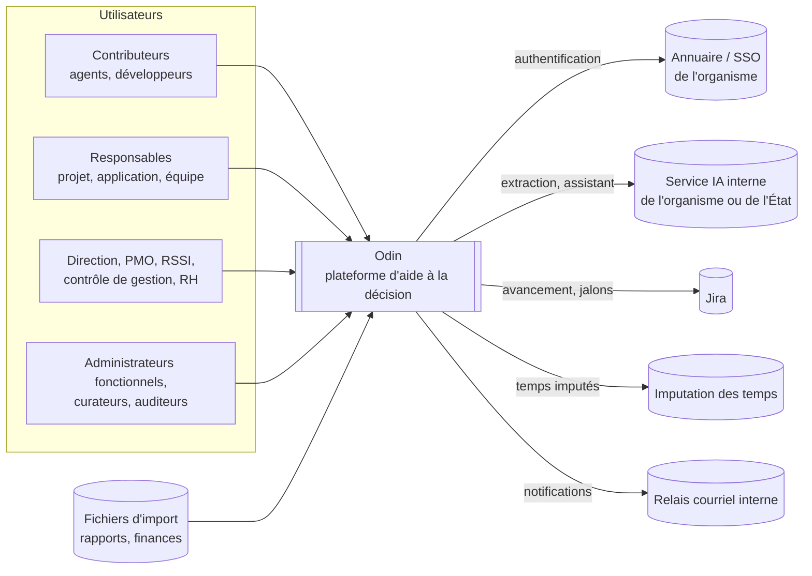
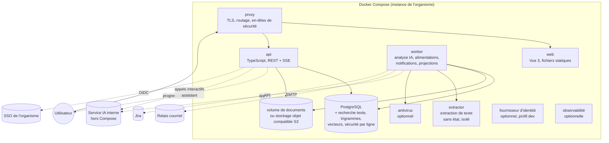
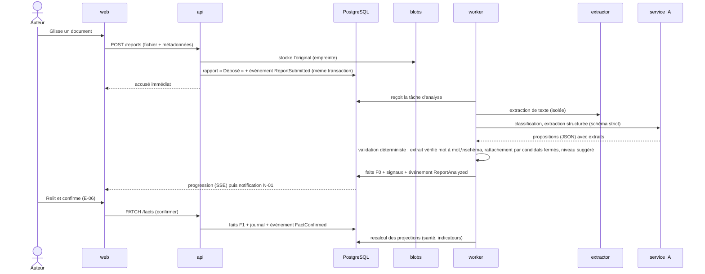

# 02. Vue d'ensemble

## 1. Style retenu (proposition)

**Monolithe modulaire** en TypeScript, **déployé en un processus d'API et un processus de worker issus du même code**, avec **une base PostgreSQL unique**. Un **service d'extraction de texte** sans état est isolé pour des raisons de sécurité. L'**IA** est un service **externe au Compose** (service interne de l'organisme), derrière un **port** remplaçable.

Pourquoi pas des microservices ? Volumes modestes, exigence de cohérence forte (droits, historique, journal), équipe de 6 à 15 personnes : les microservices **ajouteraient** des pannes réseau, de la cohérence éventuelle et de l'exploitation pour **aucun** bénéfice mesurable. Les **frontières internes** sont néanmoins strictes (voir fichier 07) pour pouvoir extraire un module si un jour la charge ou l'organisation l'exige.

## 2. Contexte (C4 niveau 1)



Frontière de confiance : **tout ce qui est à droite d'Odin est interne à l'organisme**. Aucune sortie vers Internet (K7, X14).

## 3. Conteneurs (C4 niveau 2) : le Docker Compose de référence



| Conteneur | Rôle | Sans état ? | Remplaçable par |
|---|---|---|---|
| **proxy** | TLS, routage `/` → web, `/api` → api, limitation de débit, en-têtes de sécurité | Oui | Le reverse proxy existant de l'organisme |
| **web** | Application Vue 3 compilée, servie en statique | Oui | Fichiers servis par le proxy |
| **api** | API REST, flux SSE de progression, contrôle d'accès, cas d'usage synchrones | Oui | — |
| **worker** | Tâches de fond : analyse des rapports, alimentations, calcul de santé et indicateurs, notifications, import | Oui (état en base) | Plusieurs réplicas pour monter en charge |
| **extractor** | Extraction de texte des formats bureautiques, **isolée** (réseau coupé, ressources bornées) | Oui | Bibliothèques internes, si le risque est jugé acceptable |
| **db** | PostgreSQL : données, historique, journal, files de tâches, recherche, vecteurs | **Non** | Service PostgreSQL géré de l'organisme |
| **blobs** | Documents d'origine | **Non** | Stockage objet compatible S3 de l'organisme |
| **antivirus** | Analyse des fichiers déposés (si exigé) | Oui | Antivirus de l'organisme |
| **idp** (profil dev) | Fournisseur d'identité local pour développer et tester | — | Absent en production |
| **obs** (profil) | Journaux, métriques, traces | — | Outils de supervision de l'organisme |

**Un seul composant à état critique : la base de données** (plus le stockage de documents). Cela réduit la sauvegarde, la restauration et la reprise après incident à **deux éléments**.

## 4. Découpage en modules du monolithe

Les modules **reprennent les modules fonctionnels** du fichier 05 des spécifications (traçabilité directe).

| Module technique | Modules fonctionnels | Responsabilité | Dépend de |
|---|---|---|---|
| `access` | ACC, ADM (droits), AUD (partie accès) | Identité, rôles, périmètres, habilitations, niveaux de classification, **décision d'accès et filtres** | — |
| `audit` | AUD | Journal immuable chaîné, registre d'usage de l'IA | `access` |
| `referential` | REF, ADM (référentiels) | Organisation, équipes, personnes (annuaire), services rendus, applications, initiatives légères, alias | `access` |
| `reports` | RAP | Rapports, versions, gabarits, cycle de vie, bibliothèque, brouillons | `access`, `referential`, `blobs` |
| `facts` | IAF, QUA | Faits, fiabilité, validation, contradictions, signaux, précisions, **historique** | `access`, `referential` |
| `analysis` | IAF (pipeline) | Pipeline d'analyse IA : extraction de texte, découpage, rattachement, faits proposés, détection de contenus sensibles | `reports`, `facts`, `ai-gateway` |
| `ai-gateway` | ASS, IAF | **Port** vers le service IA ; invites versionnées ; schémas de sortie ; garde-fous ; évaluation | — |
| `assistant` | ASS | Questions-réponses sourcées, **récupération filtrée par droits** | `access`, `search`, `ai-gateway`, `facts` |
| `search` | RAP, ASS | Index texte et vecteurs, **filtrage par droits** | `access` |
| `rules` | TDB (calculs) | Jeux de paramètres versionnés, **santé**, indicateurs, simulation d'impact | `facts`, `referential` |
| `dashboards` | TDB, RST | Vues stratégiques, tuiles, « Pourquoi ? », résumés | `rules`, `facts` |
| `notifications` | NOT | Notifications applicatives et courriel, boîte de tâches, relances | `access` |
| `ingestion` | ALI | Import de fichiers ; connecteurs Jira / temps ; zone d'accueil ; rapprochement | `referential`, `facts` |
| `platform` | — | Configuration, files de tâches, événements, stockage de blobs, observabilité | — |
| *(lots suivants)* | POR, ROA, DET, RSR, FIN, FOU, SEC, REG, DEC, RST | Un module par domaine | — |

**Règles de dépendance** : un module **n'accède jamais** aux tables d'un autre ; il passe par son **interface publique** ou par des **événements** (voir fichier 07 §3). Les dépendances sont **orientées** (pas de cycles) et vérifiées automatiquement.

## 5. Flux clés

### 5.1 Dépôt et analyse d'un rapport (P-02, P-05)



### 5.2 Question à l'assistant (P-22), avec filtrage des droits **avant** l'IA

```mermaid
sequenceDiagram
  actor U as Utilisateur
  participant API as api
  participant AC as access
  participant S as search
  participant L as service IA
  U->>API: Question
  API->>AC: Construit le « principal » (rôles, périmètres, habilitations)
  API->>S: recherche (texte + vecteurs) AVEC filtre de droits
  S-->>API: extraits autorisés uniquement
  API->>L: invite = règles + extraits autorisés + question
  L-->>API: réponse avec références d'extraits
  API->>API: vérifie que chaque affirmation cite un extrait autorisé ;\nrefuse si évaluation de personnes
  API-->>U: réponse + sources + fiabilité + fraîcheur
  API->>API: journalise l'usage (sans le texte)
```

### 5.3 Alimentation Jira (lot 2)

Connecteur planifié (worker) → **zone d'accueil** (données brutes horodatées) → **rapprochement** (projets Jira ↔ initiatives ; file de correspondance humaine pour l'inconnu) → faits « alimentés » (F3) → événement → recalcul des projections.

## 6. Données de configuration

- **Configuration technique** (environnement) : variables d'environnement et secrets du Compose.
- **Paramètres fonctionnels** (seuils, gabarits, niveaux de classification, grille, vocabulaire) : **en base**, versionnés, modifiables par l'administrateur avec **aperçu d'impact** (X8).

## 7. Évolutions prévues par conception

| Évolution | Ce qui la permet |
|---|---|
| Extraire un module en service (ex. `analysis`) | Frontières internes strictes, événements, pas d'accès croisé aux tables |
| Ajouter un bus d'événements externe | **Outbox transactionnelle** : un relais publie les mêmes événements (voir fichier 03 §5) |
| Passer à Kubernetes | Images OCI, configuration par variables, sondes de santé, états hors conteneur |
| Changer de modèle de langue ou de service IA | Port `ai-gateway` ; jeux d'évaluation de référence |
| Multi-organismes (hors périmètre aujourd'hui) | Non prévu ; l'isolation par instance (D3) reste la règle |
